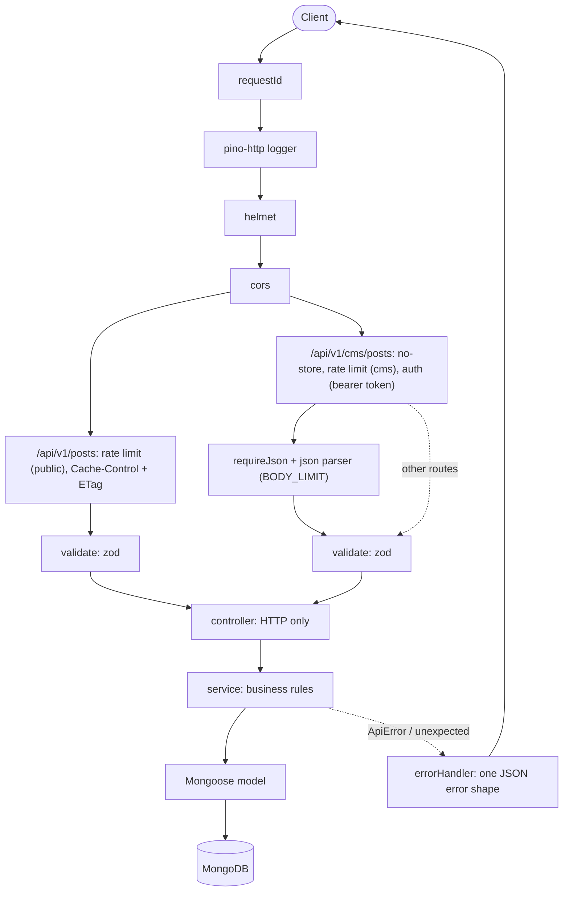

# BlogCMS API

[](https://github.com/Filippo0311603/blog-cms-api/actions/workflows/ci.yml)

REST API for a blog and its small CMS, built with Node.js, Express 5, TypeScript (strict), MongoDB/Mongoose and zod.
Readers list and filter published posts; the CMS creates, edits, publishes, unpublishes and deletes them.

> **CMS token (hardcoded, per the brief): `brianfox-cms-token`**
>
> Send it on every `/api/v1/cms/*` call: `Authorization: Bearer brianfox-cms-token`. Reader endpoints need no token.

## Quick start

```bash
npm install && npm run dev
```

With no `MONGODB_URI`, the dev server starts an in-memory MongoDB (`mongodb-memory-server`); data is lost on restart.
The first run downloads a MongoDB (`mongod`) test binary, so it needs internet once. With a real, persistent MongoDB:

```bash
docker compose up --build
```

- API: <http://localhost:3000/api/v1>, health: <http://localhost:3000/health>
- Swagger UI: <http://localhost:3000/docs> (spec: [`openapi.yaml`](openapi.yaml))
- Ready-made requests: [`requests.http`](requests.http) (VS Code REST Client)
- In zero-setup mode (in-memory DB) there is no seed: use `/docs` or `requests.http` to create and publish posts. `npm run seed` needs `MONGODB_URI`.

## Requirements to endpoints

| Brief item                           | Endpoint                                        |
| ------------------------------------ | ----------------------------------------------- |
| List public posts                    | `GET /api/v1/posts`                             |
| Create a post (status default draft) | `POST /api/v1/cms/posts`                        |
| Author always "Brian Fox"            | set by the server (`immutable` model default)   |
| Publish a post                       | `POST /api/v1/cms/posts/:id/publish`            |
| Delete a post                        | `DELETE /api/v1/cms/posts/:id`                  |
| Readers filter by hashtag            | `GET /api/v1/posts?hashtags=a,b&match=any\|all` |
| Hardcoded token on all CMS calls     | `Authorization: Bearer <token>`                 |

## API

Schemas and examples: Swagger UI at `/docs`. Success: `{ "data": Post }` or `{ "data": Post[], "meta": {...} }`.

| Method   | Path                              | Auth   | Description                                                                          | Main status codes            |
| -------- | --------------------------------- | ------ | ------------------------------------------------------------------------------------ | ---------------------------- |
| `GET`    | `/api/v1/posts`                   | none   | Published posts. Query: `hashtags`, `match` (`any`/`all`), `page`, `limit`           | 200, 304, 400, 429           |
| `GET`    | `/api/v1/posts/:id`               | none   | One published post (a draft is `404`)                                                | 200, 304, 404                |
| `GET`    | `/api/v1/cms/posts`               | Bearer | All posts, drafts included. Same query plus `status` (`draft`/`published`)           | 200, 400, 401                |
| `GET`    | `/api/v1/cms/posts/:id`           | Bearer | One post, any status                                                                 | 200, 401, 404                |
| `POST`   | `/api/v1/cms/posts`               | Bearer | Create (`title`, `body`, `hashtags?`, `status?` default `draft`); `Location` header  | 201, 400, 401, 413, 415      |
| `PATCH`  | `/api/v1/cms/posts/:id`           | Bearer | Edit `title`, `body`, `hashtags` only; unknown fields (`status`, `author`) are `400` | 200, 400, 401, 404, 413, 415 |
| `POST`   | `/api/v1/cms/posts/:id/publish`   | Bearer | Draft to published, sets `publishedAt` (idempotent)                                  | 200, 401, 404                |
| `POST`   | `/api/v1/cms/posts/:id/unpublish` | Bearer | Back to draft, `publishedAt: null` (idempotent)                                      | 200, 401, 404                |
| `DELETE` | `/api/v1/cms/posts/:id`           | Bearer | Delete                                                                               | 204, 401, 404                |
| `GET`    | `/health`                         | none   | Liveness and DB state                                                                | 200, 503                     |

A literal `#` in a URL must be sent as `%23`: `?hashtags=%23NodeJS`.

## Implicit requirements

- Drafts are invisible to readers: list and get-by-id filter on `status: published`, a draft id answers `404`.
- Validation with zod on params, query and body; every error is `{ error: { code, message, requestId?, details? } }`.
- Hashtags are normalized (NFC, trim, strip `#`, lowercase, de-duplicate), for storage and for filters.
- Pagination (`page`, `limit` default 10, capped at 100) with `meta` and a deterministic sort; indexes match the sorts.
- Publish and unpublish are idempotent; a malformed id is `404`, never `500`.
- `415` for non-JSON bodies, `413` above `BODY_LIMIT`, `429` rate limiting per IP (120/min public, 300/min CMS).
- `X-Request-Id` in the response, in every request log line and in `error.requestId`.
- Token compared in constant time, redacted from logs; env validated at startup; graceful shutdown.
- Public reads: `Cache-Control: public, no-cache` + weak ETag (`304`); CMS responses and errors are `no-store`.

## Design decisions

- **Drafts return 404, not 403, to readers**: a `403` would reveal that the id exists.
- **Strip `author` on create, reject it on PATCH**: the server owns the author; PATCH answers `400` for `author` and `status` so a client bug is not hidden. Status changes only through publish/unpublish.
- **`limit` is capped, not rejected**: `limit=1000` becomes 100 and `meta.limit` shows the effective value; `0` or `abc` are `400`.
- **`no-cache` + ETag instead of `max-age`**: a publish or delete is visible immediately; `PUBLIC_CACHE_MAX_AGE=N` switches to `max-age=N`.
- **In-memory MongoDB only in development**: outside `development` the app refuses to start without `MONGODB_URI`.

<details>
<summary>Architecture</summary>

Order below is the mount order in [`src/app.ts`](src/app.ts) and [`post.routes.ts`](src/modules/posts/post.routes.ts). The JSON body parser is mounted per CMS route, after rate limiting and auth, so a request without a valid token gets `401` even with a malformed or oversized body.



Layers: controllers only read validated input, call one service function and set status and headers; services own the business rules and throw `ApiError`; zod schemas run at the edge in `validate`; `errorHandler` is the only place that turns an error into a response.

</details>

<details>
<summary>Configuration</summary>

All variables are optional. The main ones are listed below; the rest (such as `BODY_LIMIT`, `CORS_ORIGIN`, `LOG_LEVEL` and the rate-limit settings) are in [`.env.example`](.env.example). Copy it to `.env` to customize. Invalid values stop the server at startup with a readable message.

| Variable               | Default              | Description                                                       |
| ---------------------- | -------------------- | ----------------------------------------------------------------- |
| `MONGODB_URI`          | _(empty)_            | Empty in development = in-memory MongoDB. Required otherwise.     |
| `CMS_API_TOKEN`        | `brianfox-cms-token` | Bearer token for CMS routes                                       |
| `TRUST_PROXY`          | `false`              | Express `trust proxy`: `true`/`false`, hop count, or address list |
| `PUBLIC_CACHE_MAX_AGE` | `0`                  | `max-age` (seconds) of public GETs; `0` = `public, no-cache`      |

Behind a reverse proxy set `TRUST_PROXY` (e.g. `1`), otherwise all clients share the proxy IP and one rate limit. Do not set it to `true` on a directly reachable server. Rate-limit counters are in memory, per instance.

</details>

## Docker

Compose sets `NODE_ENV=production`, `MONGODB_URI=mongodb://mongo:27017/blogcms` and `CMS_API_TOKEN` (default `brianfox-cms-token`); data lives in the `mongo-data` volume. MongoDB is pinned to 8.2.6: newer images (e.g. 8.3.13) refuse to start on Linux kernel 6.19+, which includes the `ubuntu-latest` CI runner. The image has no `tsx`: run `npm run seed` from the host against `mongodb://localhost:27017/blogcms`.

## Tests and CI

```bash
npm test
```

Run lint, typecheck, format check and build with `npm run lint`, `typecheck`, `format:check`, `build`.

Vitest + Supertest on the real Express app and a real MongoDB (in memory): endpoints, validation, auth, caching, rate limiting, request ids, log redaction, hashtag normalization, env parsing and the HTTP edge cases (bad encodings, bad bodies).
CI ([`ci.yml`](.github/workflows/ci.yml)) runs lint, typecheck, format check, tests and build, plus a `docker` job that brings up the compose stack and runs [`scripts/smoke.sh`](scripts/smoke.sh).

## What I'd do next

- **Real authentication and roles**: per-user credentials or JWT instead of one shared token.
- **Search and slugs**: a text index for full-text search and a unique slug per post.
- **Shared rate-limit store and cursor pagination**: Redis for limits across instances; a `(publishedAt, _id)` cursor for deep pages.
