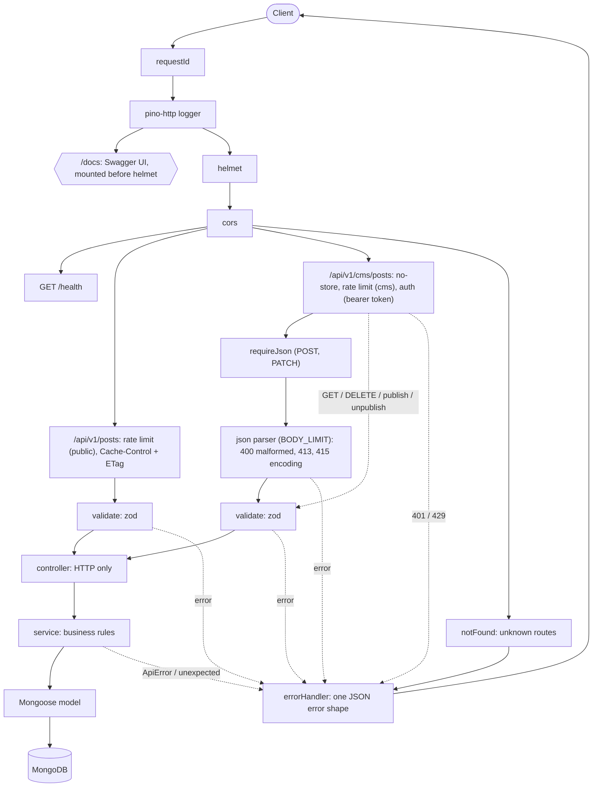

# BlogCMS API

[](https://github.com/Filippo0311603/blog-cms-api/actions/workflows/ci.yml)

A REST API for a blog and its small CMS, built with **Node.js, Express 5, TypeScript (strict), MongoDB/Mongoose and zod**.
Readers list and filter published posts; the CMS (behind a hardcoded bearer token) creates, edits, publishes, unpublishes and deletes them.
Beyond the five calls in the brief it covers the unwritten requirements: draft privacy, validation, a uniform error shape, pagination, caching, rate limiting,
request tracing and a container that is smoke-tested in CI. Tests: 92, all against a real MongoDB (in memory).

## Quick start (30 seconds)

> **CMS token (hardcoded, per the brief): `brianfox-cms-token`**
>
> Send it on every `/api/v1/cms/*` call: `Authorization: Bearer brianfox-cms-token`. Reader endpoints need no token.

```bash
npm install && npm run dev
```

With no `MONGODB_URI`, the dev server starts an **in-memory MongoDB** (`mongodb-memory-server`): zero setup, data is lost on restart.
The first run downloads a `mongod` binary, so it needs internet once. Alternative with a real, persistent MongoDB:

```bash
docker compose up --build
```

| What                | Where                                                                                                                                     |
| ------------------- | ----------------------------------------------------------------------------------------------------------------------------------------- |
| API                 | <http://localhost:3000/api/v1>                                                                                                            |
| Swagger UI          | <http://localhost:3000/docs> (raw spec at `/docs/openapi.json`, source: [`openapi.yaml`](openapi.yaml))                                   |
| Ready-made requests | [`requests.http`](requests.http) (VS Code REST Client; every endpoint, happy path and error cases)                                        |
| Health              | <http://localhost:3000/health> (`503` when the database is down)                                                                          |
| Sample data         | `npm run seed` from a second terminal (needs `MONGODB_URI`; **replaces all posts**; refuses `NODE_ENV=production` without `SEED_FORCE=1`) |

To use a real MongoDB with `npm run dev`: `docker compose up -d mongo`, then `cp .env.example .env` and set `MONGODB_URI=mongodb://localhost:27017/blogcms`.
Outside `development`, `MONGODB_URI` is mandatory. Production build: `npm run build && MONGODB_URI=... CMS_API_TOKEN=... NODE_ENV=production npm start`.

## Requirements to implementation

| Brief item                                                   | Endpoint                                        | Implemented in                                                                                                                                                                           | Proven by                                                                                                                      |
| ------------------------------------------------------------ | ----------------------------------------------- | ---------------------------------------------------------------------------------------------------------------------------------------------------------------------------------------- | ------------------------------------------------------------------------------------------------------------------------------ |
| List public posts                                            | `GET /api/v1/posts`                             | [`listPublished`](src/modules/posts/post.service.ts) (filter `status: published`, newest first)                                                                                          | [`posts.test.ts`](test/integration/posts.test.ts): "lists only published posts, newest publishedAt first"                      |
| Create a post: title, body, hashtags, status (default draft) | `POST /api/v1/cms/posts`                        | [`createPostBody`](src/modules/posts/post.schema.ts) (zod) and [`create`](src/modules/posts/post.service.ts)                                                                             | `posts.test.ts`: "creates a draft authored by Brian Fox...", hashtag normalization, `publishedAt` when created as published    |
| Author always "Brian Fox"                                    | (same)                                          | [`POST_AUTHOR`](src/modules/posts/post.model.ts) as an `immutable` schema default; a client-sent `author` is stripped; `PATCH` is strict                                                 | same test (author ignored on create); "rejects author with 400" (`PATCH`, same file)                                           |
| Publish a post                                               | `POST /api/v1/cms/posts/:id/publish`            | [`publish`](src/modules/posts/post.service.ts): conditional atomic `findOneAndUpdate` on `status: draft`                                                                                 | `posts.test.ts`: "publishes a draft...", "is idempotent..."                                                                    |
| Delete a post                                                | `DELETE /api/v1/cms/posts/:id`                  | [`remove`](src/modules/posts/post.service.ts), `204` then `404`                                                                                                                          | `posts.test.ts`: "deletes with 204, then 404"                                                                                  |
| Readers filter by hashtag                                    | `GET /api/v1/posts?hashtags=a,b&match=any\|all` | [`hashtagFilter`](src/modules/posts/post.service.ts) (`$in` / `$all`) and [`hashtagsQuery`](src/modules/posts/post.schema.ts)                                                            | `posts.test.ts`: "filters by hashtag with match=any... and match=all..."; `regressions.test.ts`: repeated `hashtags` parameter |
| No auth system: hardcoded token, documented                  | all `/api/v1/cms/*`                             | [`requireBearerToken`](src/middlewares/auth.ts), default in [`env.ts`](src/config/env.ts) (`DEFAULT_CMS_API_TOKEN`); documented here, in `openapi.yaml`, `requests.http`, `.env.example` | `posts.test.ts`: "authentication on CMS routes" (401 on every CMS route and on malformed credentials; readers need no token)   |

## Implicit requirements we handled

| Requirement                       | What the code does                                                                                                                                                                                                                                                      | Why                                                                                     |
| --------------------------------- | ----------------------------------------------------------------------------------------------------------------------------------------------------------------------------------------------------------------------------------------------------------------------- | --------------------------------------------------------------------------------------- |
| Drafts invisible to readers       | Reader list and get-by-id filter on `status: published`; a draft id answers `404`, not `403`                                                                                                                                                                            | A `403` would confirm the draft exists                                                  |
| Author enforced server-side       | `immutable` model default; ignored on create, rejected (`400`) on `PATCH`                                                                                                                                                                                               | The client must not be able to forge authorship                                         |
| Hashtag normalization             | NFC, trim, strip leading `#`, lowercase, de-duplicate ([`hashtags.ts`](src/modules/posts/hashtags.ts)); 1-50 letters/digits/underscore, max 20 per post. The same function normalizes reader filters                                                                    | `#NodeJS`, `nodejs` and a decomposed `città` are one tag, for storage and for filtering |
| Any/all matching                  | `match=any` (default) uses `$in`, `match=all` uses `$all`                                                                                                                                                                                                               | Readers need both "one of" and "all of" semantics                                       |
| Pagination with meta              | `page`, `limit` (default 10, capped at 100) on both lists; response has `meta: { page, limit, total, totalPages }`; sort is deterministic (`_id` tie-break)                                                                                                             | Unbounded lists do not scale; stable pages need a total order                           |
| Validation, one error shape       | zod on params, query and body; all problems reported together as `400 VALIDATION_ERROR` with `details[]`. Every error is `{ error: { code, message, requestId?, details? } }`; stack traces only in development                                                         | Clients write one error handler; nothing internal leaks                                 |
| Idempotent publish/unpublish      | Already-published post returned untouched (`publishedAt` kept); an existing draft is returned untouched on unpublish                                                                                                                                                    | Safe to retry; concurrent calls cannot overwrite the date                               |
| `404` for malformed ids           | Id is checked in the service (`assertValidId`), not in zod, so it is `404`, never a `CastError`/`500` or a `400`. Invalid percent-encoding in the path (`/posts/%zz`) is `404` too                                                                                      | A malformed id cannot match any post: same answer as "no such post"                     |
| `415` and `413`                   | `requireJson` returns `415` for a non-JSON body on `POST`/`PATCH`; the body parser answers `415` for an unsupported `Content-Encoding` and `413` above `BODY_LIMIT` (100kb); a `POST` without a body is a `400` validation error; other framework 4xx keep their status | Reject early with the right code instead of a confusing `400`/`500`                     |
| Rate limiting                     | `express-rate-limit`, per IP, fixed window: 120/min public, 300/min CMS (counted apart, CMS limiter runs before auth so token guessing is throttled); `429` with `RateLimit-*` and `Retry-After`; `/health` and `/docs` are exempt                                      | Basic abuse protection                                                                  |
| Request ids                       | `X-Request-Id` reused if well-formed (up to 128 of `A-Za-z0-9_.:-`), otherwise a UUID; in the response header, every log line and `error.requestId`                                                                                                                     | A client report can be matched to the server logs                                       |
| ETag / 304, `no-store` on the CMS | Public reads: `Cache-Control: public, no-cache` + weak `ETag`, `If-None-Match` gets `304`. CMS responses and every error: `no-store` and no `ETag`                                                                                                                      | Cheap revalidation for readers; drafts and authenticated data are never cached          |
| Token redaction in logs           | pino `redact`: `Authorization` and `Cookie` request headers and `Set-Cookie` response header logged as `[REDACTED]`                                                                                                                                                     | Credentials must not end up in log storage                                              |
| Constant-time token compare       | SHA-256 of both values, then `timingSafeEqual` ([`safeEqual`](src/middlewares/auth.ts))                                                                                                                                                                                 | No timing side channel; hashing equalizes lengths                                       |
| Indexes matching the sorts        | `{status, publishedAt, _id}` (reader list), `{createdAt, _id}` (CMS list), `{hashtags}` (multikey filter) in [`post.model.ts`](src/modules/posts/post.model.ts)                                                                                                         | Lists are served from an index, not an in-memory sort                                   |
| Graceful shutdown                 | `SIGINT`/`SIGTERM`: stop accepting connections, close the DB, exit; forced exit after 10 s ([`server.ts`](src/server.ts))                                                                                                                                               | No dropped in-flight requests on deploy; works with `docker stop`                       |
| Docker smoke-tested in CI         | Multi-stage image, non-root user, `HEALTHCHECK`; the `docker` CI job runs `compose up --build --wait` and [`scripts/smoke.sh`](scripts/smoke.sh) (health, create, publish, list)                                                                                        | The container is proven to work, not just to build                                      |
| Also                              | Env validated at startup (fail fast); `helmet`; configurable `CORS_ORIGIN`; `X-Powered-By` off; `/health` returns `503` when the DB is down; Express 5 forwards async errors, so no `asyncHandler`                                                                      | Security and operability basics                                                         |

## API overview

Details, schemas and examples: **Swagger UI at `/docs`** and [`openapi.yaml`](openapi.yaml). Success: `{ "data": Post }` or `{ "data": Post[], "meta": {...} }`.

| Method   | Path                              | Auth   | Description                                                                          | Main status codes            |
| -------- | --------------------------------- | ------ | ------------------------------------------------------------------------------------ | ---------------------------- |
| `GET`    | `/api/v1/posts`                   | none   | Published posts. Query: `hashtags`, `match` (`any`/`all`), `page`, `limit`           | 200, 304, 400, 429           |
| `GET`    | `/api/v1/posts/:id`               | none   | One published post (a draft is `404`)                                                | 200, 304, 404                |
| `GET`    | `/api/v1/cms/posts`               | Bearer | All posts, drafts included. Same query plus `status` (`draft`/`published`)           | 200, 400, 401                |
| `GET`    | `/api/v1/cms/posts/:id`           | Bearer | One post, any status                                                                 | 200, 401, 404                |
| `POST`   | `/api/v1/cms/posts`               | Bearer | Create (`title`, `body`, `hashtags?`, `status?` default `draft`); `Location` header  | 201, 400, 401, 413, 415      |
| `PATCH`  | `/api/v1/cms/posts/:id`           | Bearer | Edit `title`, `body`, `hashtags` only; unknown fields (`status`, `author`) are `400` | 200, 400, 401, 404, 413, 415 |
| `POST`   | `/api/v1/cms/posts/:id/publish`   | Bearer | Draft to published, sets `publishedAt` (idempotent)                                  | 200, 401, 404                |
| `POST`   | `/api/v1/cms/posts/:id/unpublish` | Bearer | Back to draft, `publishedAt: null` (idempotent)                                      | 200, 401, 404                |
| `DELETE` | `/api/v1/cms/posts/:id`           | Bearer | Delete                                                                               | 204, 401, 404                |
| `GET`    | `/health`                         | none   | Liveness and DB state                                                                | 200, 503                     |

A literal `#` in a URL must be sent as `%23` (a raw `#` starts the URL fragment and never reaches the server): `?hashtags=%23NodeJS`.

```bash
TOKEN=brianfox-cms-token; BASE=http://localhost:3000

# Create (draft by default; the id is in the body and in the Location header)
curl -i -X POST $BASE/api/v1/cms/posts \
  -H "Authorization: Bearer $TOKEN" -H "Content-Type: application/json" \
  -d '{"title":"Hello","body":"First post","hashtags":["#NodeJS","typescript"]}'

# Publish (replace $ID)
curl -X POST $BASE/api/v1/cms/posts/$ID/publish -H "Authorization: Bearer $TOKEN"

# Readers: filter by hashtags, posts having all of them
curl "$BASE/api/v1/posts?hashtags=nodejs,typescript&match=all&page=1&limit=5"
```

## Architecture

Order below is the real mount order in [`src/app.ts`](src/app.ts) and the routers in [`post.routes.ts`](src/modules/posts/post.routes.ts). The JSON body parser is mounted per CMS route, after rate limiting and auth, so a request without a valid token gets `401` (and counts against the limiter) even with a malformed or oversized body.



```
src/
  app.ts                   builds the Express app without listening (tests drive it with Supertest)
  server.ts                DB init, listen, graceful shutdown
  config/env.ts            environment parsing and validation (zod), fail fast
  db/index.ts              connect/disconnect, in-memory fallback in development
  middlewares/             requestId, auth, rateLimit, cacheControl, requireJson, jsonBody, validate, notFound, errorHandler
  modules/posts/           post.routes, post.controller, post.service, post.model, post.schema, hashtags
  docs/swagger.ts          serves openapi.yaml at /docs
  utils/                   ApiError, logger
  scripts/seed.ts
test/                      unit/ and integration/ (Vitest, Supertest, in-memory MongoDB)
openapi.yaml, requests.http, Dockerfile, docker-compose.yml, scripts/smoke.sh
```

Layering rules:

- **Controllers are thin**: read validated input, call one service function, set the HTTP status and headers. No business logic, no Mongoose.
- **Services own the business rules**: draft visibility, idempotent publish, id checks, filters, pagination. They throw `ApiError`; they know nothing about HTTP objects.
- **zod schemas live at the edge**: `validate` parses params, query and body before the controller runs and hands over typed, normalized values.
- **Cross-cutting concerns are middlewares**; `errorHandler` is the only place that turns an error into a response.

## Design decisions and trade-offs

- **Drafts return 404, not 403 to readers**: a `403` leaks that the id exists. Alternative: `403`, simpler to debug but informative to an attacker.
- **Strip on create, strict on PATCH**: a client-sent `author` on create is ignored (the server owns it; harmless), while `PATCH` rejects `author`/`status` with `400` so a silent no-op cannot hide a client bug; status changes go through publish/unpublish. Alternative: strict everywhere, or strip everywhere.
- **Cap `limit` instead of rejecting it**: `limit=1000` becomes 100 and `meta.limit` shows the effective value; clients keep working. Invalid values (`0`, `abc`) are still `400`. Alternative: `400` on anything above 100.
- **`no-cache` + ETag instead of `max-age`**: a publish or delete is visible immediately and revalidation is a cheap `304`. `PUBLIC_CACHE_MAX_AGE=N` switches to `max-age=N` when staleness is acceptable. Alternative: a default `max-age`, faster but stale.
- **In-memory MongoDB only in development**: zero-setup review; outside `development` the app refuses to start without `MONGODB_URI` so data is never silently lost. `mongodb-memory-server` is a devDependency, imported dynamically, and absent from the image.
- **A single hardcoded token**: the brief asks for no auth system; it is compared in constant time, overridable via `CMS_API_TOKEN`, and the server warns when the default is in use. Alternative: JWT with users and roles (see "What I'd do next").
- **No repository layer**: services use Mongoose directly; one model does not justify another abstraction. Alternative: repository interface, useful if the store changes.
- **MongoDB pinned to 8.2.6** (compose and CI): newer images refuse to start on Linux kernel 6.19+, which includes the 7.0 kernel of the `ubuntu-latest` runner.

## Configuration

All variables are optional; copy [`.env.example`](.env.example) to `.env` to customize. Invalid values stop the server at startup with a readable message.

| Variable                | Default              | Description                                                       |
| ----------------------- | -------------------- | ----------------------------------------------------------------- |
| `NODE_ENV`              | `development`        | `development`, `test` or `production` (empty = development)       |
| `PORT`                  | `3000`               | HTTP port, 1-65535                                                |
| `MONGODB_URI`           | _(empty)_            | Empty in development = in-memory MongoDB. Required otherwise.     |
| `CMS_API_TOKEN`         | `brianfox-cms-token` | Bearer token for CMS routes                                       |
| `BODY_LIMIT`            | `100kb`              | Max JSON body size                                                |
| `CORS_ORIGIN`           | `*`                  | `*` or comma-separated origins                                    |
| `LOG_LEVEL`             | `info`               | pino level (`silent` to mute)                                     |
| `TRUST_PROXY`           | `false`              | Express `trust proxy`: `true`/`false`, hop count, or address list |
| `RATE_LIMIT_WINDOW_MS`  | `60000`              | Rate limit window in ms                                           |
| `RATE_LIMIT_PUBLIC_MAX` | `120`                | Requests per window per IP on public reader routes                |
| `RATE_LIMIT_CMS_MAX`    | `300`                | Requests per window per IP on CMS routes                          |
| `PUBLIC_CACHE_MAX_AGE`  | `0`                  | `max-age` (seconds) of public GETs; `0` = `public, no-cache`      |

Behind a reverse proxy or load balancer set `TRUST_PROXY` (e.g. `1`), otherwise all clients share the proxy IP and one rate limit.
Never set it to `true` on a directly reachable server: clients could spoof `X-Forwarded-For`. Rate-limit counters are in memory, so each instance counts alone.

With Docker, compose sets `NODE_ENV=production`, `MONGODB_URI=mongodb://mongo:27017/blogcms` and `CMS_API_TOKEN` (default `brianfox-cms-token`, overridable from the shell or a `.env` next to `docker-compose.yml`).
The API waits for the MongoDB healthcheck; data lives in the `mongo-data` volume. The image has no `tsx`, so run `npm run seed` from the host against `mongodb://localhost:27017/blogcms`.

## Testing and quality

```bash
npm test
```

**92 tests** (Vitest + Supertest on the real Express app; mongod started once by `globalSetup`, one database per test file):

| File                                                                      | Tests | Covers                                                                                                                                                                                                                                                                                                    |
| ------------------------------------------------------------------------- | ----- | --------------------------------------------------------------------------------------------------------------------------------------------------------------------------------------------------------------------------------------------------------------------------------------------------------- |
| [`integration/posts.test.ts`](test/integration/posts.test.ts)             | 52    | Create defaults and author, normalization, validation, malformed JSON, `413`, `401` on every CMS route (also before the body is read, even with a declared but unsent body), draft visibility, hashtag filters, pagination, PATCH, publish/unpublish, delete, health, unknown routes, OpenAPI, safe `500` |
| [`integration/http.test.ts`](test/integration/http.test.ts)               | 11    | Request ids, `Cache-Control`/ETag/`304`/`max-age`, `no-store` and no ETag on CMS, `no-store` on errors, `429` and `RateLimit-*` headers, separate public/CMS counters                                                                                                                                     |
| [`integration/regressions.test.ts`](test/integration/regressions.test.ts) | 8     | Bad percent-encoding, corrupt gzip, unknown `Content-Encoding` (`415`), non-JSON `Content-Type` (`415`), idempotent unpublish, repeated `hashtags`, CMS hashtag filter, no `X-Powered-By`                                                                                                                 |
| [`integration/logging.test.ts`](test/integration/logging.test.ts)         | 1     | The bearer token never appears in the logs                                                                                                                                                                                                                                                                |
| [`unit/hashtags.test.ts`](test/unit/hashtags.test.ts)                     | 11    | Normalization, de-duplication, Unicode NFC/NFD, validity rules                                                                                                                                                                                                                                            |
| [`unit/env.test.ts`](test/unit/env.test.ts)                               | 8     | Defaults, empty strings, invalid values, `TRUST_PROXY`, rate-limit and cache settings                                                                                                                                                                                                                     |
| [`unit/db.test.ts`](test/unit/db.test.ts)                                 | 1     | No in-memory fallback outside development                                                                                                                                                                                                                                                                 |

**CI** ([`.github/workflows/ci.yml`](.github/workflows/ci.yml), on push and pull request to `main`):

- **`verify`**: `npm ci`, ESLint, `tsc --noEmit` (tests included), Prettier check, tests (mongod 8.2.6, cached), build.
- **`docker`**: `docker compose up -d --build --wait`, then [`scripts/smoke.sh`](scripts/smoke.sh) (health, create, publish, filtered list); dumps compose diagnostics on failure and tears the stack down.

## Project scripts

| Command                           | Description                                          |
| --------------------------------- | ---------------------------------------------------- |
| `npm run dev`                     | Dev server with reload (tsx)                         |
| `npm run build` / `npm start`     | Compile to `dist/` / run the compiled server         |
| `npm test`                        | Vitest: unit + integration tests                     |
| `npm run lint` / `npm run format` | ESLint / Prettier (`npm run format:check` verifies)  |
| `npm run typecheck`               | `tsc --noEmit` (includes tests)                      |
| `npm run seed`                    | Replace all posts with samples (needs `MONGODB_URI`) |

## What I'd do next

- **Real authentication and roles**: per-user credentials or JWT instead of one shared token, so the author is the authenticated user rather than a constant.
- **Search and slugs**: a text index (or Atlas Search) for full-text search, and a unique slug per post for readable URLs.
- **Shared rate-limit store**: Redis behind `express-rate-limit`, so limits hold across several API instances.
- **Cursor pagination**: `skip`/`limit` gets slower on deep pages; a cursor on `(publishedAt, _id)` would stay constant.
- **Observability**: metrics and a readiness probe separate from liveness, and a CORS allow-list by default instead of `*`.
